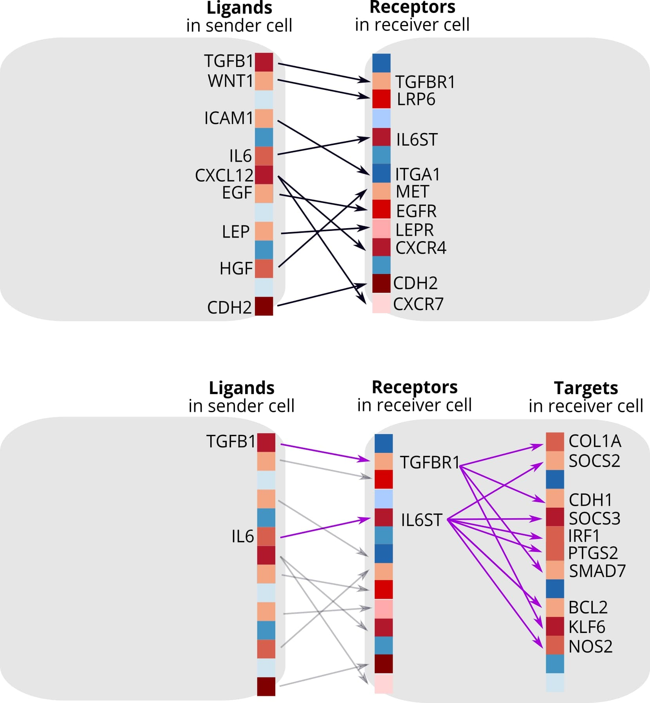
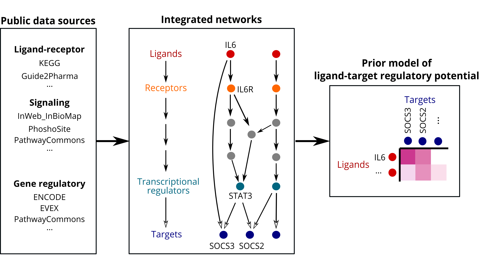

# nichenetr 

<!-- badges: start -->
[](https://zaoqu-liu.r-universe.dev/nichenetr)
[](https://github.com/Zaoqu-Liu/nichenetr/actions)
[](https://codecov.io/gh/Zaoqu-Liu/nichenetr)
[](https://doi.org/10.5281/zenodo.3260758)
[](https://doi.org/10.5281/zenodo.7074291)
[](https://www.nature.com/articles/s41592-019-0667-5)
<!-- badges: end -->

## Overview

**NicheNet** is a computational framework for modeling intercellular communication by linking extracellular ligands to downstream intracellular gene regulatory changes. Unlike conventional ligand-receptor inference methods that solely identify potential receptor-ligand interactions based on co-expression patterns, NicheNet integrates prior knowledge of signaling pathways and gene regulatory networks to predict which ligands from sender cells are most likely to affect gene expression in receiver cells.

The core innovation of NicheNet lies in its **ligand-target prior model**, which connects ligands to their downstream target genes through a probabilistic framework integrating:
- Ligand-receptor interactions
- Intracellular signaling cascades  
- Transcription factor-target gene regulatory relationships

This approach enables researchers to generate mechanistic hypotheses about cell-cell communication events observed in transcriptomic data.

### Key Publications

> Browaeys R, Saelens W, Saeys Y. **NicheNet: modeling intercellular communication by linking ligands to target genes.** *Nature Methods* 17, 159–162 (2020). [doi:10.1038/s41592-019-0667-5](https://doi.org/10.1038/s41592-019-0667-5)

> Guilliams M, Bonnardel J, et al. **Spatial proteogenomics reveals distinct and evolutionarily conserved hepatic macrophage niches.** *Cell* 185, 379-396 (2022). [doi:10.1016/j.cell.2021.12.018](https://doi.org/10.1016/j.cell.2021.12.018)

For a comprehensive best practices workflow, see:
> **Unraveling cell-cell communication with NicheNet by inferring active ligands from transcriptomics data.** *Nature Protocols* (2024). [doi:10.1038/s41596-024-01121-9](https://doi.org/10.1038/s41596-024-01121-9)

---

## Installation

### From R-universe (Recommended)

```r
install.packages("nichenetr", repos = "https://zaoqu-liu.r-universe.dev")
```

### From GitHub

```r
if (!requireNamespace("devtools", quietly = TRUE)) {
  install.packages("devtools")
}
devtools::install_github("Zaoqu-Liu/nichenetr")
```

### System Requirements

- **R version**: ≥ 4.0.0
- **Operating systems**: Windows, macOS, Linux
- **Dependencies**: Seurat (v4/v5), tidyverse, igraph, Matrix, Rcpp

---
## Methodological Framework

<details>
<summary><h3>Conceptual Comparison with Existing Methods</h3></summary>

NicheNet fundamentally differs from conventional cell-cell communication inference approaches:

| Aspect | Traditional Methods | NicheNet |
|--------|-------------------|----------|
| **Scope** | Ligand-receptor pairs only | Ligand → Receptor → Signaling → TF → Target genes |
| **Output** | Binary interaction predictions | Probabilistic ligand activity scores |
| **Validation** | Expression-based | Functional gene regulatory effects |
| **Mechanistic insight** | Limited | Signaling pathway inference |



</details>

<details>
<summary><h3>Prior Knowledge Model Architecture</h3></summary>

The NicheNet prior model integrates three layers of biological knowledge:

1. **Ligand-Receptor Layer**: Curated interactions from multiple databases (OmniPath, KEGG, etc.)
2. **Signaling Layer**: Intracellular signal transduction pathways
3. **Gene Regulatory Layer**: Transcription factor-target gene relationships

These layers are combined using a **Personalized PageRank** algorithm to compute ligand-target regulatory potential scores.



</details>

<details>
<summary><h3>Core Analytical Capabilities</h3></summary>

- **Ligand Activity Analysis**: Rank ligands by their ability to predict observed transcriptional responses
- **Target Gene Prediction**: Identify downstream genes regulated by prioritized ligands
- **Signaling Path Inference**: Reconstruct putative signaling cascades from ligand to target
- **Multi-condition Comparison**: Differential analysis across biological conditions or spatial niches
- **Custom Model Construction**: Build organism-specific or context-specific prior models

</details>

---

## Quick Start

### Input Requirements

NicheNet requires:
1. **Expression data**: Single-cell or bulk RNA-seq (Seurat object or expression matrix)
2. **Cell type annotations**: Sender and receiver cell populations
3. **Gene set of interest**: Differentially expressed genes in receiver cells

### Basic Workflow

```r
library(nichenetr)
library(Seurat)
library(tidyverse)

# Load pre-built prior model (human or mouse)
ligand_target_matrix <- readRDS(url("https://zenodo.org/record/7074291/files/ligand_target_matrix_nsga2r_final_mouse.rds"))
lr_network <- readRDS(url("https://zenodo.org/record/7074291/files/lr_network_mouse_21122021.rds"))
weighted_networks <- readRDS(url("https://zenodo.org/record/7074291/files/weighted_networks_nsga2r_final_mouse.rds"))

# Run NicheNet analysis
nichenet_output <- nichenet_seuratobj_aggregate(
  seurat_obj = seurat_obj,
  receiver = "Receiver_CellType",
  sender = c("Sender_CellType1", "Sender_CellType2"),
  condition_oi = "Treatment",
  condition_reference = "Control",
  condition_colname = "condition",
  ligand_target_matrix = ligand_target_matrix,
  lr_network = lr_network,
  weighted_networks = weighted_networks
)

# Visualize results
nichenet_output$ligand_activity_target_heatmap
```

---

## Tutorials and Vignettes

### Getting Started

| Vignette | Description |
|----------|-------------|
| [Step-by-step Seurat Analysis](vignettes/seurat_steps.md) | Comprehensive walkthrough of NicheNet workflow |
| [Seurat Wrapper Function](vignettes/seurat_wrapper.md) | Streamlined analysis using wrapper functions |
| [Ligand Activity on Gene Sets](vignettes/ligand_activity_geneset.md) | Analysis without Seurat objects |

### Advanced Applications

| Vignette | Description |
|----------|-------------|
| [Expression-based Prioritization](vignettes/seurat_steps_prioritization.md) | Incorporate ligand/receptor expression in ranking |
| [Signaling Path Inference](vignettes/ligand_target_signaling_path.md) | Reconstruct ligand-to-target signaling cascades |
| [Single-cell Ligand Activity](vignettes/ligand_activity_single_cell.md) | Cell-level ligand activity scoring |

### Visualization

| Vignette | Description |
|----------|-------------|
| [Circos Plot Visualization](vignettes/seurat_wrapper_circos.md) | Create publication-ready circos plots |
| [Advanced Circos Plots](vignettes/circos.md) | Customized ligand-receptor-target visualization |

### Model Development

| Vignette | Description |
|----------|-------------|
| [Custom Model Construction](vignettes/model_construction.md) | Build organism-specific prior models |
| [LIANA Integration](vignettes/model_construction_with_liana.md) | Use LIANA databases for model construction |
| [Model Evaluation](vignettes/model_evaluation.md) | Benchmark and validate models |
| [Parameter Optimization](vignettes/parameter_optimization.md) | NSGA-II based hyperparameter tuning |

---

## Data Resources

### Pre-built Prior Models (v2)

| Resource | Species | Link |
|----------|---------|------|
| Ligand-Target Matrix | Human | [Zenodo](https://zenodo.org/record/7074291/files/ligand_target_matrix_nsga2r_final.rds) |
| Ligand-Target Matrix | Mouse | [Zenodo](https://zenodo.org/record/7074291/files/ligand_target_matrix_nsga2r_final_mouse.rds) |
| Weighted Networks | Human | [Zenodo](https://zenodo.org/record/7074291/files/weighted_networks_nsga2r_final.rds) |
| Weighted Networks | Mouse | [Zenodo](https://zenodo.org/record/7074291/files/weighted_networks_nsga2r_final_mouse.rds) |
| LR Network | Human | [Zenodo](https://zenodo.org/records/10229222/files/lr_network_human_allInfo_30112033.rds) |
| LR Network | Mouse | [Zenodo](https://zenodo.org/record/7074291/files/lr_network_mouse_21122021.rds) |

---

## Frequently Asked Questions

See the comprehensive [FAQ page](vignettes/faq.md) for answers to common questions about:
- Choosing between sender-agnostic and sender-focused approaches
- Handling multiple conditions or time points
- Interpreting ligand activity scores
- Cross-species analysis considerations

---

## Related Tools

- **[MultiNicheNet](https://github.com/saeyslab/multinichenetr)**: Multi-sample, multi-condition extension for complex experimental designs
- **[LIANA](https://github.com/saezlab/liana)**: Ligand-receptor analysis framework with multiple method integration

---

## Citation

If you use NicheNet in your research, please cite:

```bibtex
@article{browaeys2020nichenet,
  title={NicheNet: modeling intercellular communication by linking ligands to target genes},
  author={Browaeys, Robin and Saelens, Wouter and Saeys, Yvan},
  journal={Nature Methods},
  volume={17},
  number={2},
  pages={159--162},
  year={2020},
  publisher={Nature Publishing Group},
  doi={10.1038/s41592-019-0667-5}
}
```

---

## License

This project is licensed under the GPL-3.0 License.

## Contact

For questions and bug reports, please open an issue on [GitHub](https://github.com/Zaoqu-Liu/nichenetr/issues).
