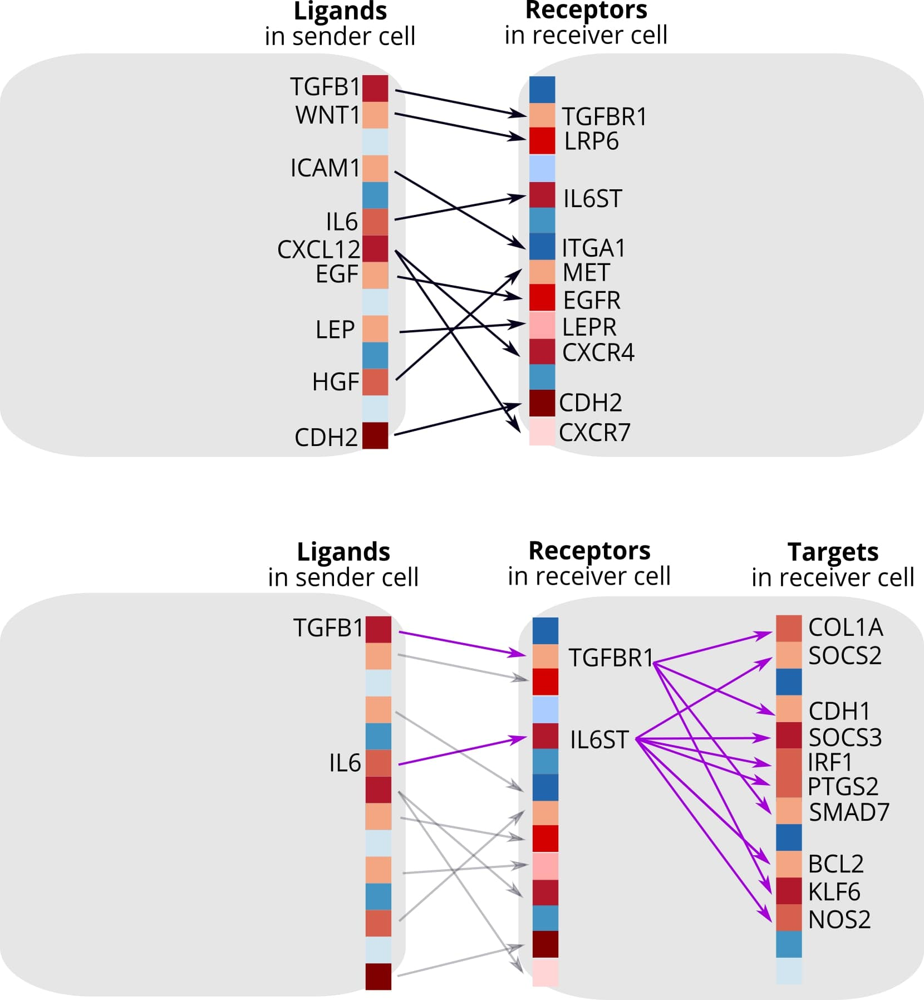
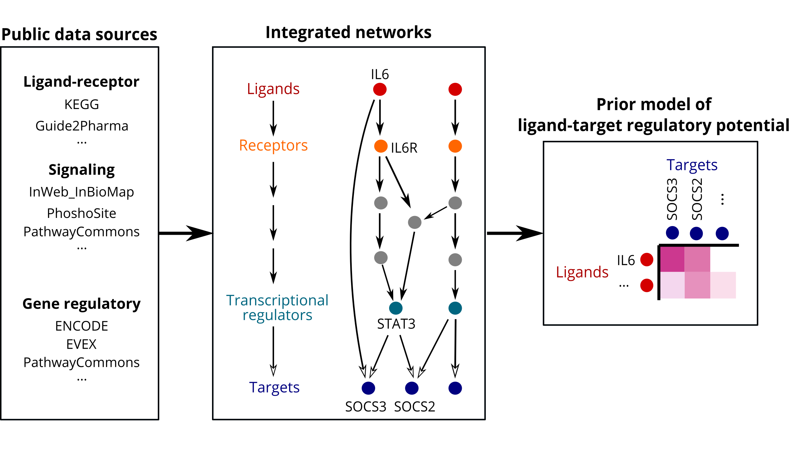

```{r setup, include=FALSE}
knitr::opts_chunk$set(
  echo = TRUE,
  message = FALSE,
  warning = FALSE,
  fig.width = 8,
  fig.height = 6,
  fig.align = "center"
)
```

# Introduction

**NicheNet** is a computational method for modeling intercellular communication by linking extracellular ligands to intracellular gene regulatory changes. This vignette provides a comprehensive overview of the NicheNet algorithm, its underlying principles, and how it differs from conventional cell-cell communication inference approaches.

## The Challenge of Cell-Cell Communication Analysis

Traditional approaches to study cell-cell communication (CCC) focus primarily on identifying ligand-receptor interactions based on gene expression:

1. **Expression-based methods**: Identify co-expressed ligand-receptor pairs between cell types
2. **Database-driven methods**: Match expressed genes to curated ligand-receptor databases
3. **Statistical methods**: Score interactions based on expression levels and specificity

**Limitation**: These methods cannot predict the downstream functional effects of ligand-receptor signaling.

## NicheNet's Innovation

NicheNet addresses this limitation by:

1. **Integrating prior knowledge** of signaling pathways and gene regulation
2. **Predicting target genes** affected by each ligand
3. **Ranking ligands** by their ability to explain observed transcriptional changes

```{r concept-diagram, echo=FALSE, fig.cap="Conceptual comparison of NicheNet with traditional approaches"}
# Conceptual diagram would be loaded here

```

# Algorithm Architecture

## Three-Layer Prior Model

NicheNet's prior knowledge model integrates three biological layers:

### Layer 1: Ligand-Receptor Interactions

Curated from multiple databases including:

- **OmniPath** - Comprehensive signaling database
- **KEGG** - Pathway-based interactions
- **Reactome** - Reaction-based annotations
- **Guide to PHARMACOLOGY** - Drug-target data

### Layer 2: Signaling Networks

Intracellular signal transduction pathways connecting receptors to transcription factors (TFs):

- Kinase-substrate relationships
- Protein-protein interactions in signaling cascades
- Second messenger systems

### Layer 3: Gene Regulatory Networks

Transcription factor-target gene relationships:

- ChIP-seq derived TF binding sites
- Regulatory network inference results
- Promoter motif predictions

```{r model-architecture, echo=FALSE, fig.cap="NicheNet prior model architecture"}

```

## Network Integration Algorithm

### Weighted Network Aggregation

Each data source $s$ is assigned a weight $w_s \in [0, 1]$:

$$W_{ij} = \sum_{s \in S} w_s \cdot \mathbf{1}_{(i,j) \in E_s}$$

where:
- $W_{ij}$ is the aggregated weight between nodes $i$ and $j$
- $S$ is the set of all data sources
- $E_s$ is the edge set from source $s$

### Hub Correction

To prevent hub nodes from dominating predictions:

$$W_{ij}^{corrected} = W_{ij} \cdot d_j^{-h}$$

where:
- $d_j$ is the in-degree of node $j$
- $h \in [0, 1]$ is the hub correction factor

# Ligand-Target Score Computation

## Personalized PageRank (PPR)

NicheNet uses Personalized PageRank to compute ligand-target regulatory potential scores.

### Algorithm Description

For a ligand $L$, the PPR vector $\pi_L$ is computed iteratively:

$$\pi_L^{(t+1)} = (1-\alpha) \cdot \mathbf{e}_L + \alpha \cdot W^T \cdot \pi_L^{(t)}$$

where:
- $\alpha$ is the damping factor (default: 0.5)
- $\mathbf{e}_L$ is the restart vector (1 for ligand, 0 elsewhere)
- $W$ is the normalized adjacency matrix

### Interpretation

- **High $\pi_L(g)$**: Gene $g$ is strongly connected to ligand $L$ through the signaling network
- **Damping factor**: Controls the balance between local (receptor-proximal) and global (downstream) effects

```{r ppr-visualization, echo=FALSE, fig.cap="Personalized PageRank propagation from ligand to targets"}
library(ggplot2)
library(dplyr)

# Create example PPR decay visualization
set.seed(42)
steps <- 0:10
ppr_values <- 0.5^steps  # Exponential decay example

ppr_df <- data.frame(
  step = steps,
  ppr = ppr_values
)

ggplot(ppr_df, aes(x = step, y = ppr)) +
  geom_line(color = "#0d6efd", linewidth = 1.2) +
  geom_point(color = "#0d6efd", size = 3) +
  scale_y_continuous(labels = scales::percent) +
  labs(
    title = "PageRank Signal Decay",
    subtitle = "Probability of random walker reaching downstream nodes",
    x = "Network Distance from Ligand",
    y = "PageRank Score"
  ) +
  theme_minimal() +
  theme(
    plot.title = element_text(face = "bold", size = 14),
    plot.subtitle = element_text(color = "gray50")
  )
```

## Alternative Methods

### Shortest Path Length (SPL)

For comparison, NicheNet also supports SPL-based scoring:

$$S_{L \to g} = \frac{1}{d(L, g)}$$

where $d(L, g)$ is the weighted shortest path distance.

**Trade-off**: SPL captures direct signaling paths but may miss parallel signaling routes.

# Ligand Activity Prediction

## Problem Formulation

Given:
- **Gene set of interest** $G$: Differentially expressed genes in receiver cells
- **Background genes** $B$: All expressed genes
- **Ligand-target matrix** $M$: Pre-computed regulatory potential scores

**Goal**: Rank ligands by their ability to predict $G$ from $B$.

## Evaluation Metrics

### Area Under ROC Curve (AUROC)

Measures discrimination ability:

$$AUROC = P(M_{L,g^+} > M_{L,g^-})$$

where $g^+ \in G$ and $g^- \in B \setminus G$.

### Area Under Precision-Recall Curve (AUPR)

More sensitive for imbalanced data:

$$AUPR = \sum_{k} (R_k - R_{k-1}) \cdot P_k$$

### Pearson Correlation

Linear relationship between scores and target membership:

$$r = \frac{\sum_g (M_{Lg} - \bar{M}_L)(y_g - \bar{y})}{\sqrt{\sum_g (M_{Lg} - \bar{M}_L)^2 \sum_g (y_g - \bar{y})^2}}$$

where $y_g = 1$ if $g \in G$, else $y_g = 0$.

```{r metrics-comparison, echo=FALSE, fig.cap="Comparison of evaluation metrics for ligand ranking"}
# Simulated metric comparison
set.seed(123)
n_ligands <- 20

metrics_df <- data.frame(
  ligand = paste0("Ligand", 1:n_ligands),
  auroc = sort(runif(n_ligands, 0.4, 0.95), decreasing = TRUE),
  aupr = sort(runif(n_ligands, 0.1, 0.8), decreasing = TRUE),
  pearson = sort(runif(n_ligands, -0.1, 0.6), decreasing = TRUE)
)

metrics_long <- tidyr::pivot_longer(
  metrics_df, 
  cols = c(auroc, aupr, pearson),
  names_to = "metric",
  values_to = "value"
)

metrics_long$metric <- factor(
  metrics_long$metric,
  levels = c("auroc", "aupr", "pearson"),
  labels = c("AUROC", "AUPR", "Pearson r")
)

ggplot(metrics_long %>% filter(ligand %in% paste0("Ligand", 1:10)), 
       aes(x = reorder(ligand, -value), y = value, fill = metric)) +
  geom_col(position = "dodge") +
  scale_fill_manual(values = c("#0d6efd", "#198754", "#dc3545")) +
  labs(
    title = "Ligand Activity Metrics Comparison",
    subtitle = "Top 10 ranked ligands",
    x = "Ligand",
    y = "Score",
    fill = "Metric"
  ) +
  theme_minimal() +
  theme(
    axis.text.x = element_text(angle = 45, hjust = 1),
    plot.title = element_text(face = "bold", size = 14),
    legend.position = "top"
  )
```

# Workflow Summary

The workflow diagram illustrates the complete NicheNet analysis pipeline from input data to final predictions.

## Step-by-Step Process

1. **Define sender and receiver cells** from expression data
2. **Identify expressed ligands** in sender cells
3. **Identify expressed receptors** in receiver cells
4. **Define gene set of interest** (e.g., DE genes in receivers)
5. **Compute ligand activities** using prior model
6. **Rank ligands** by predictive performance
7. **Infer target genes** for top ligands
8. **Visualize** ligand-target relationships

# Performance Characteristics

## Computational Complexity

| Operation | Time Complexity | Memory |
|-----------|----------------|--------|
| PPR computation | $O(n \cdot m)$ | $O(n)$ |
| Activity scoring | $O(L \cdot G \log G)$ | $O(L \cdot G)$ |
| Full analysis | ~1-5 minutes | ~2-4 GB |

Where:
- $n$ = number of genes in network
- $m$ = number of edges
- $L$ = number of ligands
- $G$ = number of genes in background

## C++ Acceleration

NicheNet includes optimized C++ implementations for:

- ROC/PR curve computation
- Batch Pearson correlation
- Matrix subsetting operations

These provide significant speedups for large-scale analyses.

# Best Practices

## Choosing Parameters

| Parameter | Recommended | Range | Notes |
|-----------|-------------|-------|-------|
| Damping factor | 0.5 | 0.1-0.9 | Higher = more local effects |
| Hub correction | 0.5 | 0-1 | Higher = stronger hub penalty |
| LTF cutoff | 0.99 | 0.9-0.999 | Sparsity of ligand-TF links |

## Interpreting Results

- **High AUROC + High Pearson**: Strong, reliable ligand candidate
- **High AUROC + Low Pearson**: May indicate non-linear effects
- **Low AUROC + High Pearson**: Check for data quality issues

# References

1. Browaeys R, Saelens W, Saeys Y. NicheNet: modeling intercellular communication by linking ligands to target genes. *Nature Methods* 17, 159–162 (2020).

2. Page L, Brin S, Motwani R, Winograd T. The PageRank citation ranking: Bringing order to the web. *Stanford InfoLab* (1999).

3. Türei D, Korcsmáros T, Saez-Rodriguez J. OmniPath: guidelines and gateway for literature-curated signaling pathway resources. *Nature Methods* 13, 966–967 (2016).

# Session Info

```{r session-info}
sessionInfo()
```
